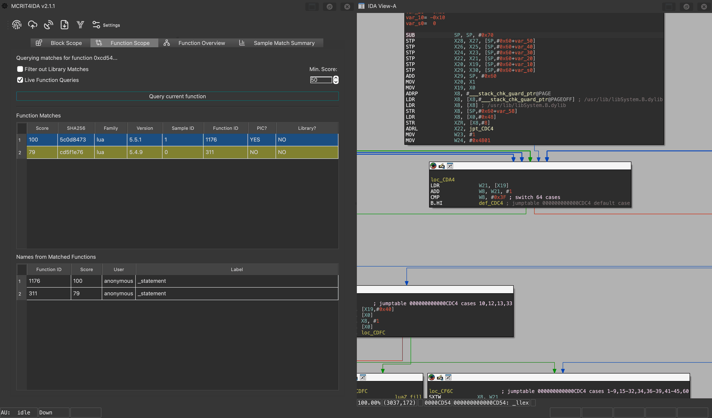
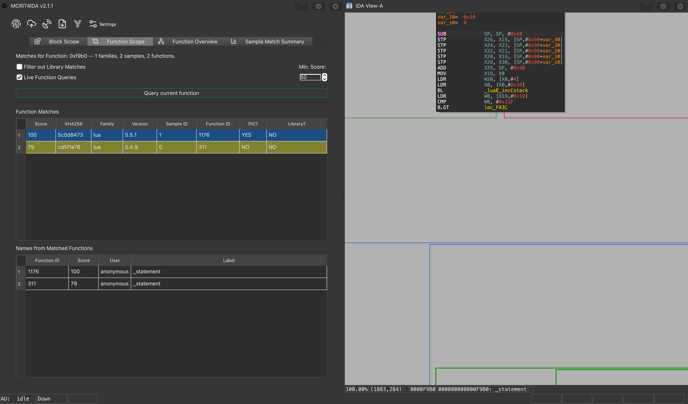
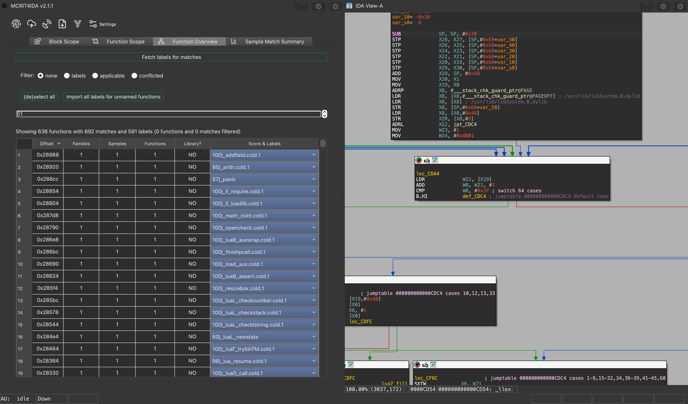
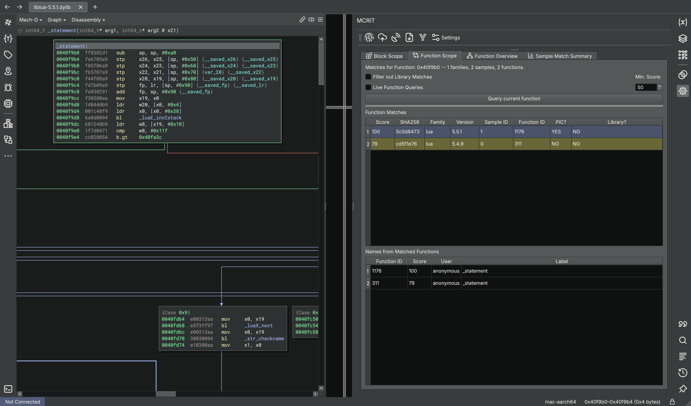
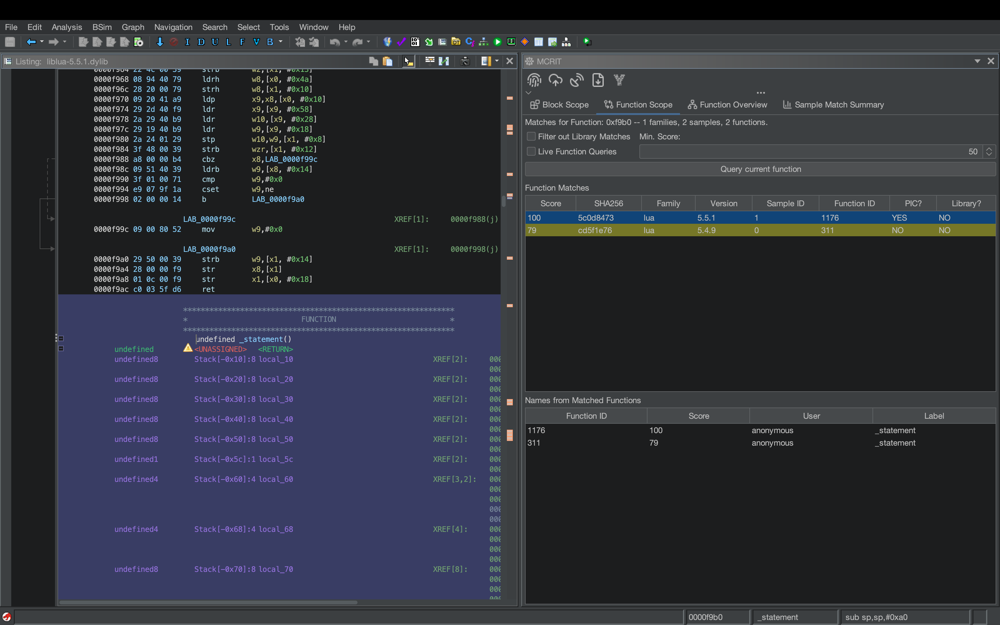

# MCRIT plugins for IDA Pro, Binary Ninja and Ghidra

[](#ida-pro)
[](#binary-ninja)
[](#ghidra)
[](LICENSE)
[](https://deepwiki.com/familiary/mcrit-plugin)

See which code in your binary you have seen before. These plugins connect your disassembler to an
[MCRIT](https://github.com/familiary/mcrit) server, the MinHash-based code similarity toolkit, and
show matching functions, blocks, samples and names right next to your analysis.



- **Function and block matches** for wherever your cursor is, as you move.
- **Function overview** of the whole sample, with names from the matches you can import.
- **Sample matches** against everything on the server, grouped by family.
- **Matched code highlighted** in your own listing, and the remote function's graph one click away.
- **YARA strings** built from a selection.

One code base, the same toolbar and tabs in all three:

| | [IDA Pro](#ida-pro) | [Binary Ninja](#binary-ninja) | [Ghidra](#ghidra) |
| :--- | :--- | :--- | :--- |
| Requires | IDA 9.0 or newer | Binary Ninja 6.0 or newer | Ghidra 12.0 or newer, PyGhidra |
| Install | `hcli plugin install mcrit-ida` | Extension Manager: **MCRIT** | Extension ZIP |
| Open | Edit → Plugins → MCRIT4IDA, <kbd>Ctrl</kbd>+<kbd>F4</kbd> | MCRIT sidebar | Tools → MCRIT, <kbd>Ctrl</kbd>+<kbd>Shift</kbd>+<kbd>M</kbd> |
| Settings | Settings button, or HCLI | Settings button, or Settings → MCRIT | Edit → Tool Options → MCRIT |

You need an MCRIT server to talk to. To run your own, [docker-mcrit](https://github.com/familiary/docker-mcrit)
brings up the whole stack, and [mcrit-data](https://github.com/familiary/mcrit-data) has reference
data to fill it with.

## IDA Pro



### Install

```bash
python -m pip install --upgrade ida-hcli
hcli plugin install mcrit-ida
```

`hcli plugin upgrade mcrit-ida` and `hcli plugin uninstall mcrit-ida` work as usual.

<details>
<summary>Other ways to install</summary>

**Manually.** Extract a release ZIP into `$IDAUSR/plugins/mcrit-ida/` and install the dependencies
with IDA's Python, then restart IDA:

```bash
python -m pip install "smda>=4.3.10" "ida-settings>=3.5.1" requests
```

A repository checkout does not work directly, because the packager puts `ida-plugin.json` and
`ida_mcrit.py` at the archive root.

**From a local build.**

```bash
python scripts/ida/package_plugin.py --repo . --output ../mcrit-ida.zip
hcli plugin install ../mcrit-ida.zip
```

**Offline.** Each release has a wheelhouse bundle. Unpack it and run
`python -m pip install --no-index --find-links=. -r requirements.txt`.

**Coming from 1.x.** 1.x was installed from the repository's old home, so `hcli plugin upgrade`
does not find 2.x. Run `hcli plugin uninstall mcrit-ida`, then install again.

**Notes.**
- SMDA 4.3.10 is the last release for Python 3.10, so an IDA running Python 3.10 stays on it.
- IDA 9.4 may ask once whether to enable PyQt5 shims when the plugin loads; answer No. The
  question comes from the `ida-settings` dependency, and the plugin uses PySide6.

</details>

### Connect

Click **Settings** on the MCRIT toolbar, also at Edit → Plugins → MCRIT4IDA Settings...
- With [ida-settings-editor](https://github.com/williballenthin/ida-settings) installed, it opens
  the Plugin Settings Manager on mcrit-ida.
- Without it, a small form asks for the server, API token, username and timeout.

From a shell, HCLI sets the same values:

```bash
hcli plugin config mcrit-ida set mcrit_server https://mcrit.example.com/api/
```

In CI, pass them at install time so HCLI doesn't prompt:
`hcli plugin install mcrit-ida --config mcrit_server=https://mcrit.example.com/api/`.

### Use

1. Open a binary and start MCRIT4IDA from Edit → Plugins, or press <kbd>Ctrl</kbd>+<kbd>F4</kbd>.
2. On the toolbar, convert the database to an SMDA report, upload it, and fetch a matching result.
3. Browse the Block Scope, Function Scope, Function Overview and Sample Match Summary tabs.

Opening a match's graph highlights the matched blocks of your function in IDA's own views. The
highlight is only drawn, never saved to the database, and Edit → Plugins → MCRIT4IDA Clear Match
Coloring removes it.



## Binary Ninja



### Install

Open the Extension Manager (command palette: **Manage Extensions**), search for **MCRIT** and
install it. Binary Ninja installs the Python dependencies with it.

<details>
<summary>Other ways to install</summary>

**From a clone.** Clone this repository into your Binary Ninja user plugins folder (Plugins → Open
Plugin Folder...), then install `requirements.txt` into Binary Ninja's Python.

**Offline.** Each release has a `binja` wheelhouse bundle, built for Windows and Python 3.11 to
3.13. Install it like the IDA bundle.

</details>

### Connect

Click **Settings** on the MCRIT toolbar, or open Plugins → MCRIT → Settings. Both open Binary
Ninja's Settings on the MCRIT group.
- Where a system keychain is available, an API token entered there moves into the keychain.
  Plugins → MCRIT → Clear Stored API Token removes it.
- Closing that Settings tab reconnects with the new values. After changing them some other way,
  reopen the file.

### Use

Open the MCRIT sidebar, or run any MCRIT action from the command palette or Plugins → MCRIT.
Reports come from Binary Ninja's own analysis, matched blocks are highlighted in your graph and
linear views, and remote CFGs open as graph reports.

## Ghidra

> [!NOTE]
> The Ghidra plugin is new and not released yet; its version is 0.1.0. Until the first release,
> you build the extension ZIP yourself, as shown below.



### Install

Ghidra runs the plugin in PyGhidra mode, on the JDK it asks for: 21 up to Ghidra 12.1, 25 from
12.2.

1. Build the extension ZIP from a clone of this repository:

   ```bash
   python scripts/ghidra/package_extension.py --repo . --output mcrit-ghidra.zip --ghidra-version <your Ghidra version>
   ```

2. Start Ghidra with `support/pyghidraRun` (`support\pyghidraRun.bat` on Windows). The first start
   offers to set up PyGhidra's Python environment.
3. In the project window, open File → Install Extensions, click **+**, pick the ZIP and restart
   Ghidra. A ZIP built for another Ghidra version installs too, after a warning.
4. Install the dependencies into PyGhidra's environment. MCRIT shows the exact command for your
   install the first time it misses them. On Linux, for example:

   ```bash
   ~/.config/ghidra/ghidra_<version>/venv/bin/python -m pip install "smda>=4.9.0" requests
   ```

5. In the CodeBrowser, open Window → Script Manager, find `MCRIT.py` in the MCRIT category and
   tick **In Tool**. That adds Tools → MCRIT and <kbd>Ctrl</kbd>+<kbd>Shift</kbd>+<kbd>M</kbd>.

<details>
<summary>Run it straight from a clone</summary>

Skip steps 1 and 3. Instead, add `mcrit_plugin/ghidra/ghidra_scripts` from the clone under Script
Manager → Manage Script Directories.

</details>

The first start compiles a small Java class for the MCRIT window into Ghidra's settings folder.
It is rebuilt by itself for a new plugin or Ghidra version.

### Connect

Open Edit → Tool Options → MCRIT. The connection settings are read when MCRIT opens for a program,
so reopen the program after changing them. The API token field is masked, but Ghidra stores it with
the tool's options in plain text.

### Use

Run Tools → MCRIT. The window docks into the CodeBrowser with one session per open program and
follows the program you switch to. Matched blocks are marked in the listing without changing the
program, Clear Match Coloring in the MCRIT window's menu removes the marks, and remote CFGs open in
Ghidra's graph view.

## Settings

All three plugins share the same settings; [settings.json](mcrit_plugin/core/settings.json) lists
every one with its type and default. These are the ones you will set first:

| Setting | What it is | Example |
| :--- | :--- | :--- |
| `mcrit_server` | Server URL | `https://mcrit.example.com/api/` |
| `mcritweb_api_token` | MCRITweb API token; it implies the username | `eyJ0eXAi...` |
| `mcritweb_username` | Username, optional | `analyst` |
| `mcrit_request_timeout` | Request timeout in seconds, 0 for none | `10` |

To force settings regardless of what the disassembler stores, put a `config_override.json` in the
plugin's folder. That is next to `ida_mcrit.py` in IDA, next to `plugin.json` in Binary Ninja, and
in the extension's folder (`Extensions/MCRIT` in Ghidra's settings folder) or the clone's root in
Ghidra. [The template](docs/config_override.json.template) shows the format. Reinstalling the
Ghidra extension replaces its folder, so keep a copy there.

## Development

[docs/development.md](docs/development.md) covers the layout, the checks, the integration tests and
how releases are made. [CHANGELOG.md](CHANGELOG.md) has the release history.

## License

GPL-3.0, see [LICENSE](LICENSE). The icons come from [Lucide](https://lucide.dev) and
[YARA-X](https://github.com/VirusTotal/yara-x); [icons/NOTICE.md](icons/NOTICE.md) has their
licences. IDA Pro, Binary Ninja and Ghidra are trademarks of their respective owners.

## Authors

- Daniel Plohmann ([@danielplohmann](https://github.com/danielplohmann))
- Rony ([@r0ny123](https://github.com/r0ny123))
